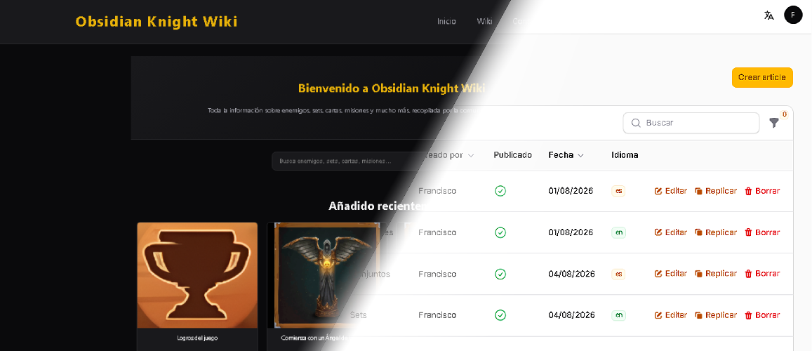

<!--
**ZomlyGames/ZomlyGames** is a ✨ _special_ ✨ repository because its `README.md` (this file) appears on your GitHub profile.

Here are some ideas to get you started:

- 🔭 I’m currently working on ...
- 🌱 I’m currently learning ...
- 👯 I’m looking to collaborate on ...
- 🤔 I’m looking for help with ...
- 💬 Ask me about ...
- 📫 How to reach me: ...
- 😄 Pronouns: ...
- ⚡ Fun fact: ...
-->

<h1 align="center">👋 Hi, I'm Francisco García</h1>

**Full-Stack Web Developer** · Galicia, Spain

## 👨‍💻 About Me

I’m a web developer with hands-on experience in both frontend and backend development, working with modern web technologies and agile development practices.

Currently developing and maintaining **[Obsidian Knight Wiki](https://obsidianknightwiki.com)**, a dedicated wiki for **[Obsidian Knight RPG](https://play.google.com/store/apps/details?id=com.actfirstgames.seven)** (video game developed by ActFirst Games).

## 🚀 Featured Project

### Obsidian Knight Wiki

Full-stack web application built from scratch and running in production.

## 🛠️ Tech Stack

| Area | Technologies |
| --- | --- |
| **Languages** | PHP · Java · JavaScript · TypeScript · HTML · CSS / SCSS |
| **Frontend** | Angular · AngularJS · Blade |
| **Backend** | Laravel · Spring Boot |
| **CMS / Admin** | Filament |
| **Infrastructure** | Docker · Cloudflare |
| **Tools** | Git · GitHub · Slack · Trello |

## 💼 Experience

**Web Developer · Qualigy Solutions Innovation**  
`March 2026 – June 2026`

Worked with Angular, TypeScript, JavaScript, HTML, SCSS, Spring Boot and AngularJS, contributing to web applications, landing pages, internationalization and reporting within a Scrum-based development environment.

## Get in touch

- 💼 [LinkedIn](https://www.linkedin.com/in/francisco-garcia-lantaron/)
- 📧 [francisco@obsidianknightwiki.com](mailto:francisco@obsidianknightwiki.com)
